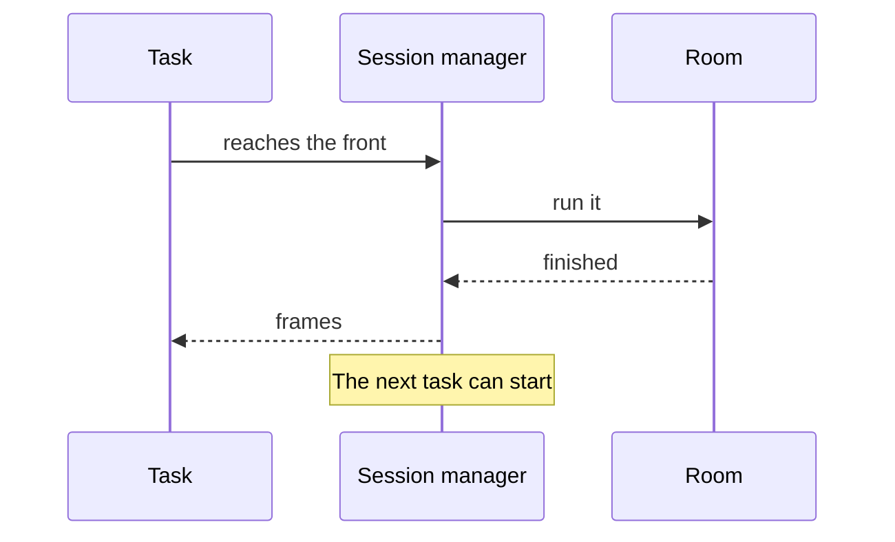
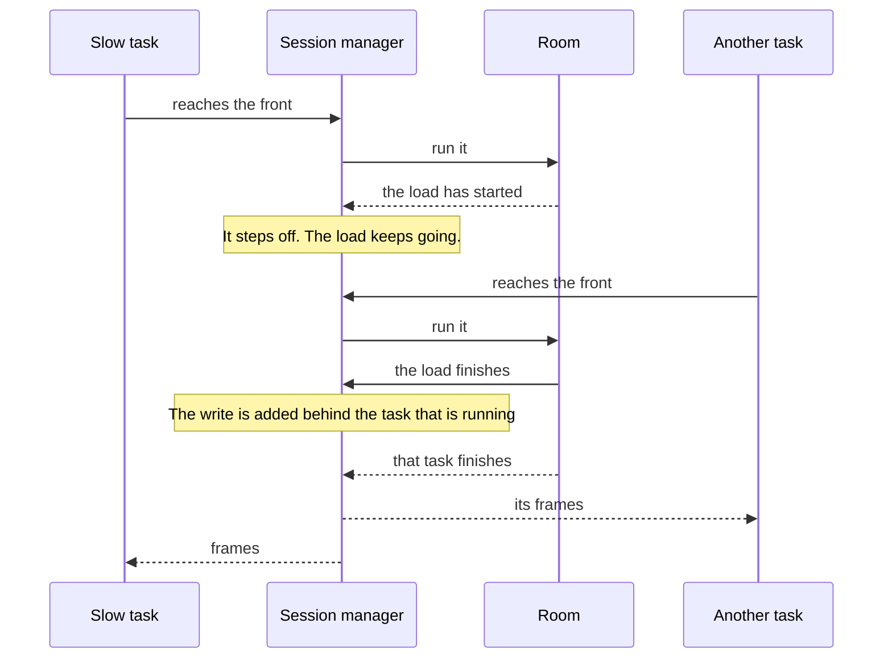

The session manager runs room work as tasks, one at a time. A new connection, a message, a presence update, a storage write, a snapshot, and a disconnect all wait on the same line. A task leaves that line early only when staying on it would block the tasks behind it.

The line moves forward only when the current task finishes. A task that is already running cannot stop and wait for the line. It would be waiting for itself.

## On the line

Some work has to be applied in order, before the next task starts. That includes a message whose handler has finished, a presence patch, and an ordinary storage write. The task stays on the line until the room has returned an effect and the session manager has written the frames. [Messages](/docs/architecture/messages#effect) shows what those frames contain.

## Off the line

A slow task still has to write its frames in order. If it stayed on the line while it waited, nothing else could run. The usual case is a host call that loads storage in [`prepare`](/docs/guides/treaty). The task waits until it reaches the front, starts the load, and steps off. The load keeps going. Tasks that arrive during that wait run to completion, and their frames are written.

When the load finishes, those frames are not written on the spot. The session manager adds a new task for the write, behind whatever is already running. In the diagram below, another task is already running when the load finishes, so the write waits until that task has written its own frames. A task that arrives after the load has finished waits behind this write.

Two storage prepares still write in the order their calls were made. Other tasks can run between them. A later prepare does not write ahead of an earlier one, even if its load finishes first.

If the load fails, that new task is never added. Nothing is written, the document stays as it was, and the host call is rejected.

The caller is still waiting through all of this. It does not get a result when the task steps off. If the load succeeds, it gets the result after the frames are written. If the load fails, it gets the error as soon as the load fails.

When the room and the session manager live in different places, a slow task can step off and not come back onto the session manager's line. The frames are sent from the room's side. [Hosted rooms](/docs/architecture/hosted) describes that split.
