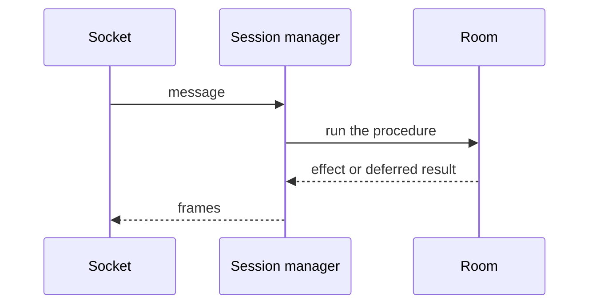

A hosted room puts the session manager and the room in different places. Each room has its own session manager. [Concepts](/docs/infrastructure/concepts) defines those two objects. [Messages](/docs/infrastructure/messages) is the order of a message once the session manager has it.

## Session manager

The session manager holds the sessions and the websockets. It orchestrates messages. Sockets deliver messages here, and the session manager decides when each one runs. It asks the room to run procedures. The room returns effects, and the effects carry frames. The session manager sends those frames on the websockets. A save and a connection leaving are orchestrated here too. The session manager does not hold the document, and it does not run the user's procedures.

## Room

The room holds the storage, the procedures the user defines, and the listeners. Storage is the document clients are editing, and the [server's storage](/docs/infrastructure/concepts#save) that document is written into. A procedure is the user's server-side handler for a message. The listeners are the callbacks the user configures, such as `onUserDisconnected` and `onStorageUpdated`. The room does not hold the sockets.

## How they relate

The session manager calls the room for a procedure, for the document, or for a listener. Only a procedure returns frames. The session manager sends those frames on the websockets.

A procedure is the call in the diagram. The room returns a deferred result or an effect. An effect carries frames, and the session manager sends those frames on the websockets. [Messages](/docs/infrastructure/messages) shows that order, including a handler that is still waiting.

The session manager asks the room to write the document into the server's storage. The room keeps the document. [Save](/docs/infrastructure/messages#save) shows when that write waits.

When a connection leaves, the session manager removes the socket first. The room then runs `onUserDisconnected`. The listener receives the room, the user, and the document. The session manager sends the broadcast frames after the listener finishes.

When a handler is still waiting, the room returns without sending. When that handler finishes, the room asks the session manager to send the broadcast frames and the self frames.
