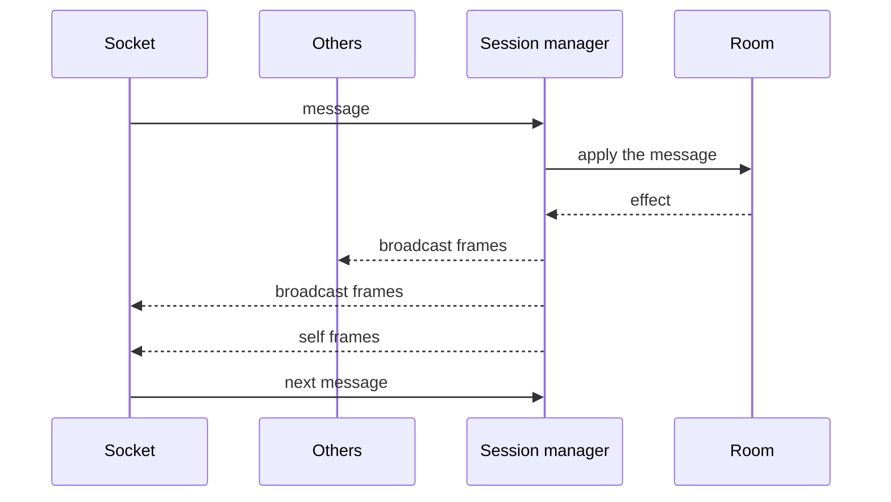
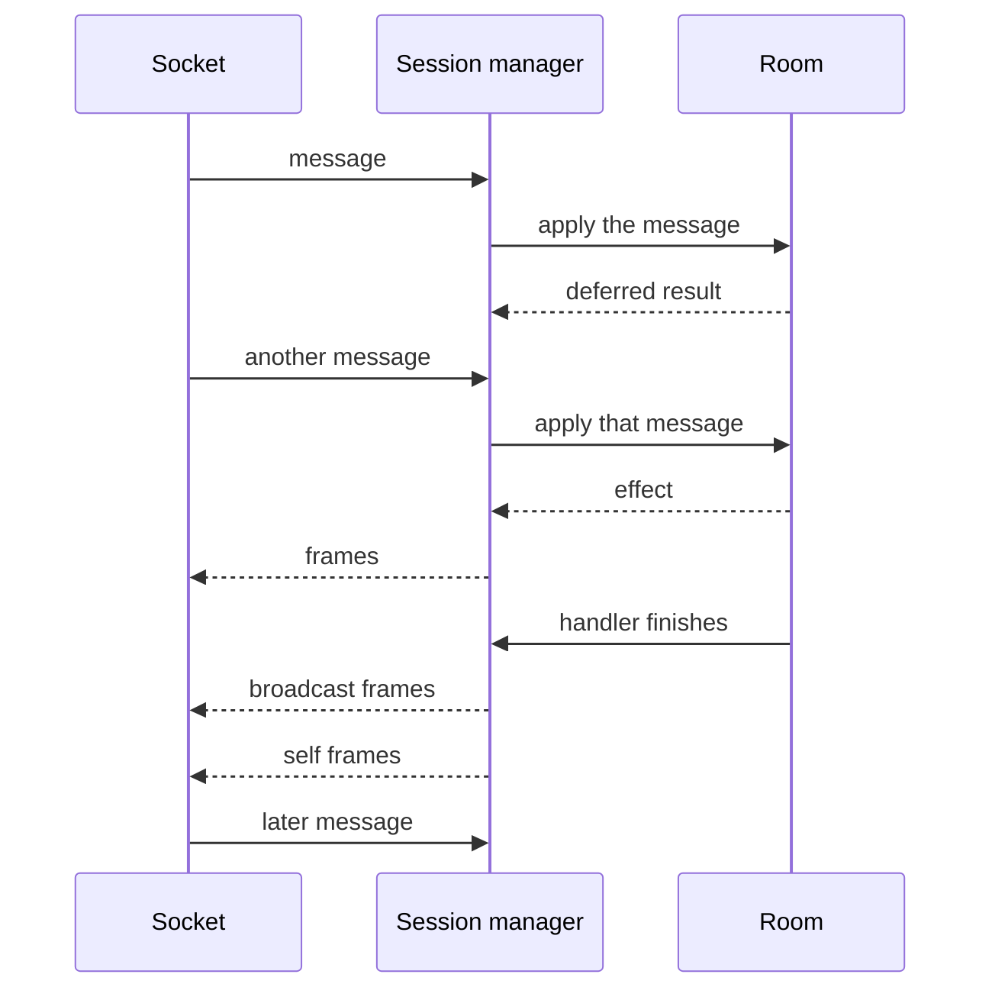
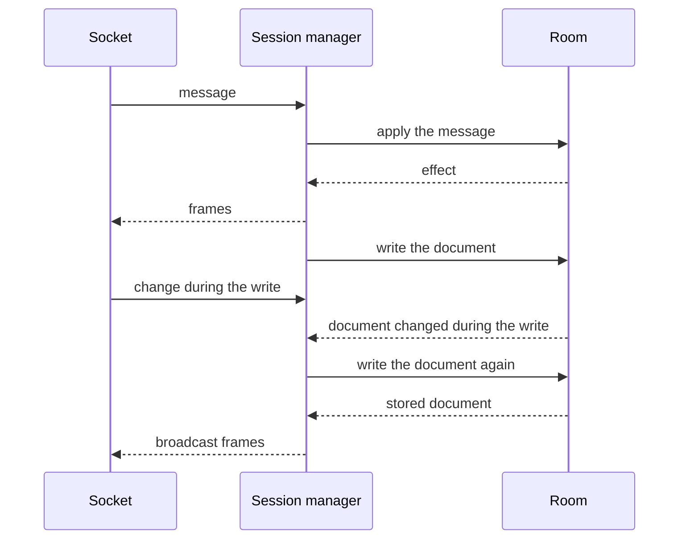
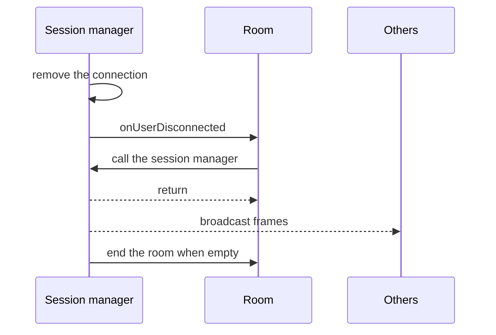

A message follows a fixed order once a room and a session manager exist. [Concepts](/docs/infrastructure/concepts) defines those objects, along with a frame, a deferred result, an effect, and a snapshot.

A socket delivers the message to the session manager. The session manager asks the room to apply it, and the room answers with one of two results.

If the handler is still waiting, that result is a deferred result and the next message can run. If the handler has finished, that result is an effect and the session manager writes its frames. The first two cases are the effect and the deferred result. A [snapshot](/docs/infrastructure/concepts#snapshot) and a connection leaving also write frames, and those frames do not come from a handler. When the room and the sockets live in different places, see [Hosted rooms](/docs/infrastructure/hosted).

## Effect

The room returns an effect. Every connection receives the broadcast frames, including the sender. The sender also receives the self frames. The next message starts after both are written.

Those broadcast frames carry the document changes. Every connection applies the changes when the frames arrive. The self frames are the sender's reply.

The room remembers document changes the clients have not received yet, and it keeps those changes on a list. This message's broadcast frames include every change on that list. The clients receive those changes from these frames. After the frames are written, the room takes those changes off the list, because the clients have them. The document still contains the changes.

## Deferred result

The room returns a deferred result when the handler is still waiting. It has no frames yet. A message from a separate handler can arrive while the first handler's deferred result is still pending, and that message is applied and its frames are written before the first handler finishes. A message that arrives after the first handler finishes waits until that handler's frames are written.

When the handler finishes and its broadcast frames are written, the room takes the document changes those frames sent off the list in [Effect](#effect).

## Snapshot

A [snapshot](/docs/infrastructure/concepts#snapshot) writes the document into the server's storage. The room loads the document from that storage when the one in memory is gone. This write is separate from `onStorageSnapshot` and `onStorageDestroyed`, which write an app's own database. The session manager waits one second after the document changes, then writes. A change during that second is included in the same write. The write still waits until the current message is done. If the document changes during the write, the session manager waits another second and writes again.

The document written to the server's storage is the whole document. The broadcast frames after that write carry changes the clients have not received yet. The message already delivered its own changes in the broadcast frames before the write, so those changes are not in this broadcast. After the snapshot's frames are written, the room takes the changes in that broadcast off the list in [Effect](#effect). If they stayed on the list, the next snapshot would send them again, and every client that already applied them would apply the same change a second time.

## A connection leaves

When a connection leaves, the session manager removes it first. `onUserDisconnected` then runs. That listener can call the session manager, and the other connections receive the broadcast frames only after it finishes. The room ends when it is empty.

The broadcast frames tell the others this connection left. They also carry document changes those connections have not received yet. After the frames are written, the room takes the changes in that broadcast off the list in [Effect](#effect), for the same reason as in [Snapshot](#snapshot).
