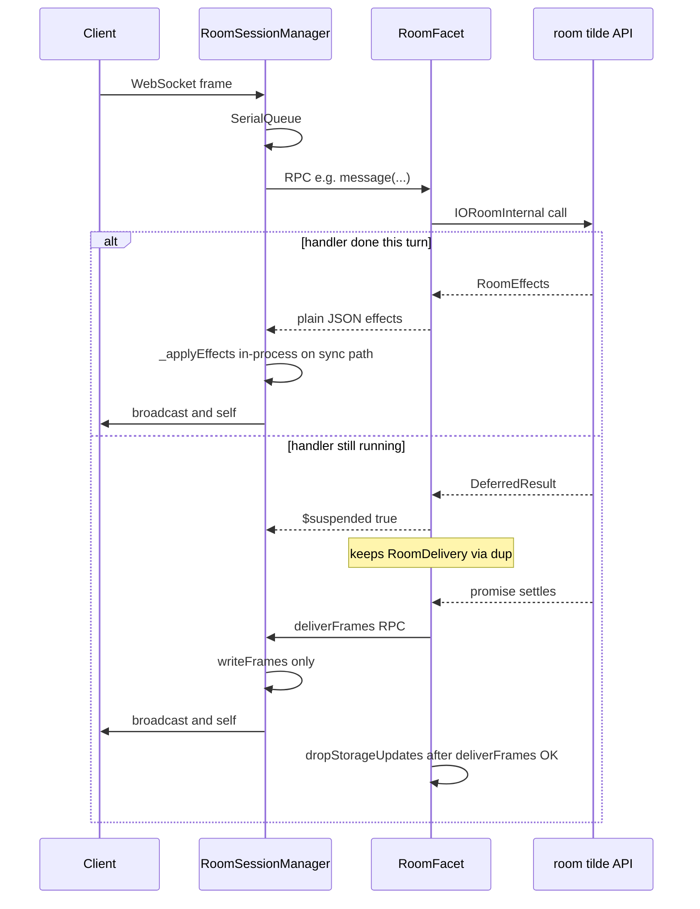

# Maintainer guide for `@pluv/io` and platform

This doc is a map of the server code. Use it when you are changing `packages/io`, the platform packages, or the CLI room supervisor.

The user-facing explanation of how a room works (frames, snapshots, the hosted split) lives in MDX under `apps/docs/content/docs/architecture/`:

- [`concepts.mdx`](../../apps/docs/content/docs/architecture/concepts.mdx)
- [`messages.mdx`](../../apps/docs/content/docs/architecture/messages.mdx)
- [`task-sequencing.mdx`](../../apps/docs/content/docs/architecture/task-sequencing.mdx)
- [`hosted.mdx`](../../apps/docs/content/docs/architecture/hosted.mdx)

Read those files on whatever branch you have checked out. The site at [docs.pluv.io](https://docs.pluv.io/docs) can lag behind `main`.

## Room vs session manager

`IORoom` is the room. It holds the live document, your event router, treaty procedures, and listener callbacks. When something happens, it decides what should happen and returns **effects**: the frames that ought to go out on the wire.

`RoomSessionManager` is the session manager. It owns the WebSockets. It runs work one task at a time, calls into the room, and sends frames to clients. It also runs the snapshot timer, ping and GC logic, and the retry queues.

The split exists so the same room logic can run in one process, or behind RPC when the room lives in a hosted Worker facet.

If the session manager needs the room, it should only use `room["~"]` (`IORoomInternal` in `packages/io/src/types.ts`). The public methods on `IORoom` are for app setup, not for the session manager.

## Two ways we run the same code

### In one process

This is the usual Node setup (`platform-node`) or a single Cloudflare Worker without facets.

1. `PluvServer.createRoom` gives you an `IORoom`.
2. `manageSessions(room)` attaches a `RoomSessionManager` in the same isolate.
3. `room["~"]` is the real `IORoom` implementation.

### Hosted (CLI room supervisor)

Sockets and the document do not share an isolate.

| Piece         | Where it lives                                             | What it does                                                                               |
| ------------- | ---------------------------------------------------------- | ------------------------------------------------------------------------------------------ |
| Supervisor DO | `packages/cli/src/room/supervisor.ts`                      | WebSockets, `RoomSessionManager`, `platformPluv` or `platformCloudflare` on the supervisor |
| User facet    | `packages/platform/src/RoomFacet.ts` (via `loadUserFacet`) | Document, treaty, listeners; each room call is RPC into `room["~"]`                        |

If a handler needs I/O (for example treaty storage `prepare`), the facet returns `{ $suspended: true }` right away. When the work finishes, frames go back through an `RpcTarget` the facet keeps alive (`RoomDelivery`, `StorageProcedureDelivery`, and `dup()`).

Hosted bugs often touch three places: `io`, `platform`, and `cli/src/room`. Fixing only `packages/io` is usually not enough.

### Hosted: one client message

Same ordering as [`messages.mdx`](../../apps/docs/content/docs/architecture/messages.mdx) and [`hosted.mdx`](../../apps/docs/content/docs/architecture/hosted.mdx). The supervisor runs the session manager; the user facet owns `IORoom`.

Treaty storage `prepare` is the same shape: `{ $suspended: true }`, then `deliverFrames` or `finish` on `StorageProcedureDelivery`.

## Who owns what

| You need                                               | Look at                                                                            |
| ------------------------------------------------------ | ---------------------------------------------------------------------------------- |
| Message handlers, document, pending storage sends      | `packages/io/src/IORoom.ts`                                                        |
| Sockets, queue, broadcast, snapshot timer, retries     | `packages/io/src/RoomSessionManager/RoomSessionManager.ts`                         |
| Room API for session manager or facet                  | `SessionRoom["~"]` in `packages/io/src/types.ts`                                   |
| One-at-a-time task queue                               | `packages/io/src/SerialQueue.ts` (`finish` steps off, then commits later)          |
| Ordering treaty storage commits                        | `packages/io/src/CommitGate.ts`                                                    |
| In-memory doc, pending client updates, seal/generation | `packages/io/src/StorageSnapshot.ts`                                               |
| `onStorageEdits` batches                               | `packages/io/src/StorageEdits.ts` and related files                                |
| Hosted RPC wrapper                                     | `packages/platform/src/RoomFacet.ts`                                               |
| DO and facet wiring                                    | `packages/cli/src/room/supervisor.ts`, `packages/platform/src/loadUserFacet.ts`    |
| Cloudflare persistence and hibernation                 | `packages/platform-cloudflare/src/CloudflarePlatform.ts`                           |
| Node `ws`                                              | `packages/platform-node/src/NodePlatform.ts`                                       |
| Built-in `$` wire protocol                             | `packages/io/src/createSessionRouter.ts`, `packages/io/src/createStorageRouter.ts` |

Session `$` events (presence, ping, list users) are routed in the session manager. Storage and user-defined events go through `IORoom._message`.

## What a handler can return

Handlers do not always finish in one turn.

| Situation                            | In one process      | Hosted (facet)                                                             |
| ------------------------------------ | ------------------- | -------------------------------------------------------------------------- |
| Done, send frames now                | `RoomEffects`       | `RoomEffects` (JSON through `RoomFacet`)                                   |
| Still running (e.g. async `prepare`) | `DeferredResult<T>` | `{ $suspended: true }`, then `deliverFrames` or `finish` on the supervisor |
| Slow presence patch                  | `DeferredResult`    | `{ $suspended: true }`, then `deliverPresence`                             |

The session manager uses `SerialQueue.finish` so slow work does not block the whole room. The current task leaves the queue while a promise runs, then comes back to write frames. That lines up with [`task-sequencing.mdx`](../../apps/docs/content/docs/architecture/task-sequencing.mdx).

While room limits are still loading, `ExclusiveUntil` serializes work the same way. Do not `await queue.run()` from inside a task that is already on the queue. Use `finish` instead.

## `$storageUpdated` is different from most frames

Most broadcast frames are fire and forget. `$storageUpdated` carries document deltas that clients might not have yet, so the server tracks them until a broadcast actually succeeds.

1. The room keeps a list of updates clients have not applied (`StorageSnapshot` pending list).
2. Those updates go out in `$storageUpdated` frames.
3. After a successful broadcast, `dropStorageUpdates` removes them from the pending list (`IORoom._dropStorageUpdates`, `RoomSessionManager._applyEffects`).
4. If the send fails, `queueStorageFrames` puts them back.

On the session manager there are two paths:

- `writeFrames` only pushes bytes to sockets.
- `applyFrames` pushes bytes and clears the pending list for frames that landed.

On hosted setups, `RoomDelivery.deliverFrames` calls `writeFrames` so the session manager does not clear the pending list. The pending list lives on the facet room. After a successful send, `RoomFacet` calls `dropStorageUpdates` on that room. Use `applyFrames` only on the in-process path where the same isolate holds both sides.

Retries (`procedureReplay` in `RoomFacet`, `_unsent` on the session manager) replay normal procedure frames without `$storageUpdated`. Those storage frames wait for the snapshot loop, which calls `flushSnapshot` and may send `$storageUpdated` with connection id `"$server"`. Clients ignore `$storageUpdated` when there is no connection id; server-side writes use that id on purpose.

## Snapshot, persistence, and `onStorageEdits`

These names get mixed up a lot.

| Name                | Who runs it                                                | What it is                                                                                                             |
| ------------------- | ---------------------------------------------------------- | ---------------------------------------------------------------------------------------------------------------------- |
| Snapshot loop       | `RoomSessionManager` (`_snapshotUntilClean`, ~1s debounce) | Writes the full document to platform persistence (DO storage, etc.) and may flush pending `$storageUpdated` to clients |
| `StorageSnapshot`   | `IORoom`                                                   | In-memory document and pending client updates. No wall-clock timer of its own.                                         |
| `onStorageSnapshot` | Your listener                                              | Your app copying the document to your database. Not the same as the core snapshot pipeline.                            |
| `onStorageEdits`    | `StorageEdits`                                             | About once per second, batched deltas for your app. Not tied to when persistence runs.                                 |

For treaty storage, `LoadedStorage.generation` is captured when `prepare` starts. If the snapshot seals before commit, that commit is dropped (`_commitLoadedStorage`).

## Things that tend to break

- Do not `await queue.run(...)` from a callback that is already on `SerialQueue`. Use `finish`.
- On Cloudflare, `platform.keepAlive` keeps the isolate up for snapshots, retries, and listener promises.
- The supervisor isolate outlives the user facet. Failed frame delivery goes to `_unsent` on the session manager.
- On Cloudflare Durable Objects, `$ping` and `$pong` are answered by the DO auto-response in `CloudflarePlatform`, not by a room procedure.
- `createIO().platform(...)` must return a new platform instance every time (`AbstractPlatform._initialize`).
- Host storage reads wait on `_storageWrites` so they see prepared treaty writes.

## Where to start in the code

| You are changing                      | Start here                                                                                                        |
| ------------------------------------- | ----------------------------------------------------------------------------------------------------------------- |
| Send order or dropping storage frames | `RoomSessionManager._applyEffects`, `_writeFrames`                                                                |
| A user-defined event                  | `IORoom._message`, `PluvRouter`                                                                                   |
| Join or register                      | `RoomSessionManager.register`, `IORoom._register`, `_initializeStorage`                                           |
| Treaty storage prepare or commit      | `IORoom._applyStorageProcedure`, `_commitLoadedStorage`; `CommitGate` in session manager `__experimental_storage` |
| Pending storage list                  | `IORoom._queueStorageFrames`, `_dropStorageUpdates`, `_releaseStorage`, `flushSnapshot`                           |
| Hosted suspend and deliver later      | `RoomFacet`, `RoomDelivery` and `StorageProcedureDelivery` in `supervisor.ts`                                     |
| A new built-in `$` event              | `createSessionRouter` or `createStorageRouter`, then `packages/client/src/PluvRoom.ts`                            |
| Host treaty invoke                    | `createHostTreatyProcedureProxy.ts`, `__experimental_storage`, `__experimental_presence`                          |

## Built-in wire events (`$…`)

Names starting with `$` are protocol, not app events. They are defined in `createSessionRouter` and `createStorageRouter`, merged into the server router, and handled on the client in `packages/client/src/PluvRoom.ts`. Payload shapes live in `packages/types` (`BaseClientEventRecord`, `BaseIOEventRecord`). App events use your `PluvRouter` on `IORoom` with normal names.

### Join and registration

- **`$initializeSession`** (client → server, session router): Sent after auth, when the client is ready to join the live room. Carries initial presence and optional CRDT sync hints. The session manager also runs `initializeStorage` for the document half. Others get **`$userJoined`** (broadcast).
- **`$registered`** (server → sender, self): Sent during `register` before the socket is fully live. Confirms the connection id, encoded auth state, and room stats.
- **`$storageReceived`** (server → sender, self): Sent on the same path when storage finishes seeding or catch-up for that connection. Tells the client whether the doc was empty, initialized, or unchanged.

### Presence and who is in the room

- **`$updatePresence`** (client → server, session router): Client or a presence treaty procedure patches presence. Others get **`$presenceUpdated`** (broadcast).
- **`$getOthers`** (client → server): Snapshot of other participants for this user. Reply **`$othersReceived`** (self only).
- **`$listUsers`** (client → server): Paginated participant list. Reply **`$usersPage`** (self only).

### Keep-alive

- **`$ping`** / **`$pong`**: Client heartbeat; server answers on the self channel. On Cloudflare Durable Objects the platform may answer `$ping` with a DO auto-response before the room runs (`CloudflarePlatform`).

### Document sync (CRDT on the wire)

- **`$syncStorage`** (client → server, storage router): Client asks for a diff against a state vector (or the whole doc). Reply **`$storageDiff`** (self).
- **`$updateStorage`** (client → server, storage router): Client pushes an encoded update (or a treaty storage procedure does). Server integrates into the doc. Others usually get **`$storageUpdated`** (broadcast). If the bytes do not integrate, the server may ask for more history with **`$storageResync`** (self to the sender).
- **`$storageUpdated`** (server → clients): Document delta for clients to merge. Also sent from snapshot flush, treaty commits, and pending-update replay. Special delivery rules apply (see above). Server-origin frames may use connection id `"$server"`.

### Leave and errors

- **`$exit`** (broadcast): A connection left. Carries session id and user.
- **`$error`** (usually self): Procedure or validation failure surfaced to the sender.

### Server pushes (no matching client `$` in the same turn)

- **`$roomStats`**: Throttled live connection counts by participant kind.
- **`$syncStateReceived`**: After register or when the room catches up, lists connection ids that should run a storage sync.

### Quick lookup

| Client sends         | Typical server replies                            | Code                                          |
| -------------------- | ------------------------------------------------- | --------------------------------------------- |
| `$initializeSession` | `$userJoined` (+ storage via `initializeStorage`) | `createSessionRouter`, `RoomSessionManager`   |
| `$getOthers`         | `$othersReceived` (self)                          | `createSessionRouter`                         |
| `$listUsers`         | `$usersPage` (self)                               | `createSessionRouter`                         |
| `$ping`              | `$pong` (self); CF DO auto-response               | `createSessionRouter`, `CloudflarePlatform`   |
| `$updatePresence`    | `$presenceUpdated`                                | `createSessionRouter`                         |
| `$syncStorage`       | `$storageDiff` (self)                             | `createStorageRouter`                         |
| `$updateStorage`     | `$storageUpdated`, maybe `$storageResync`         | `createStorageRouter`                         |
| (register)           | `$registered`, `$storageReceived` (self)          | `RoomSessionManager.register`, `IORoom`       |
| (disconnect)         | `$exit`                                           | `IORoom._close`                               |
| (snapshot / commit)  | `$storageUpdated`                                 | `flushSnapshot`, `_commitLoadedStorage`, etc. |
| (server origin)      | `$error`, `$roomStats`, `$syncStateReceived`      | `SERVER_ORIGIN_EVENTS`, session manager       |

## Public API vs internal hooks

- Apps use `createIO`, `PluvServer`, `manageSessions`, `PluvRouter`, `PluvProcedure`.
- The session manager and facet should only call `room["~"]`, not private `IORoom` methods.
- Tests and unstable helpers: `__internal` in `packages/io/src/internal.ts` (no semver guarantee).
